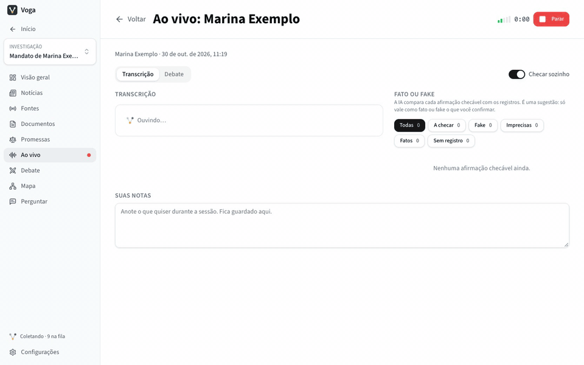
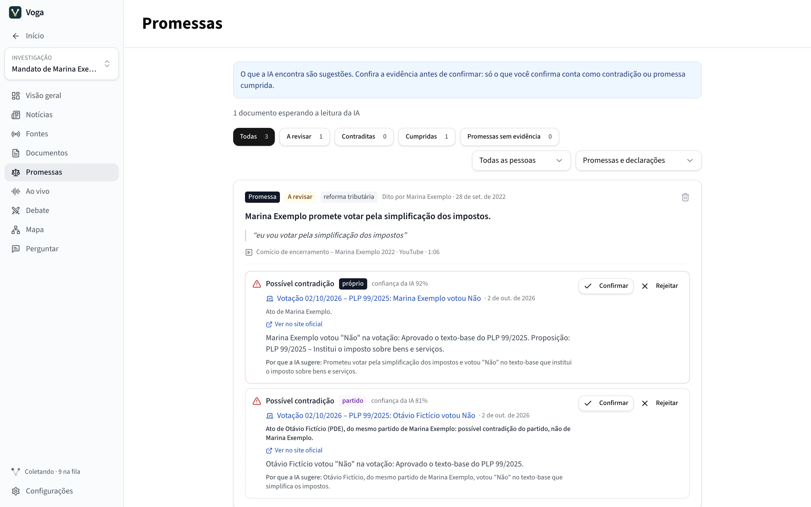
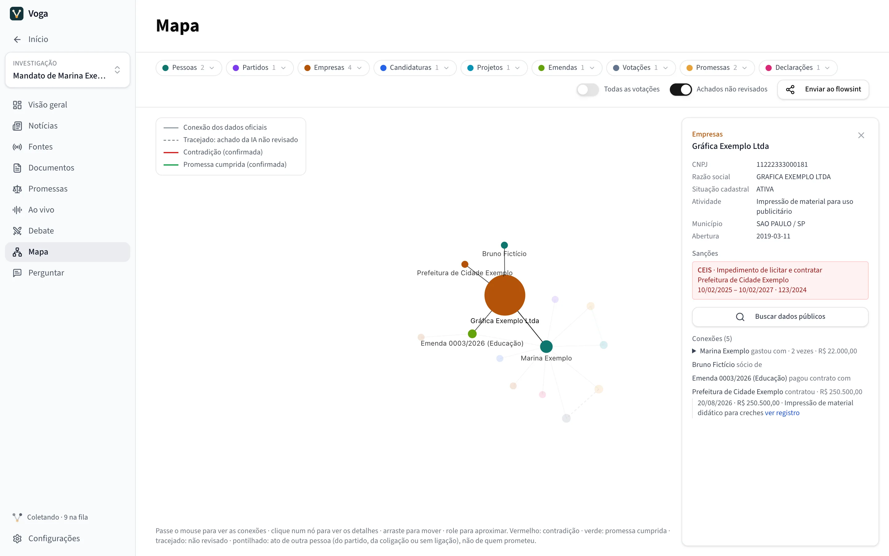

# Voga

O Voga acompanha figuras públicas, começando pelos políticos brasileiros. Ele junta o que cada pessoa promete, diz e faz (discursos, entrevistas, vídeos, notícias, posts e os dados abertos da Câmara, do Senado, do TSE e dos portais de transparência), guarda tudo no seu computador e aponta onde uma promessa foi cumprida ou contradita, com o registro ao lado.

O que a IA encontra é sugestão: só conta o que uma pessoa confirmar.

**Site:** [github.com/feliperohde/voga](https://github.com/feliperohde/voga) (página em [feliperohde.github.io/voga](https://feliperohde.github.io/voga/)). A versão atual, para Mac com Apple Silicon (M1 ou mais novo), fica em [Releases](https://github.com/feliperohde/voga/releases/latest).



*Ao vivo, na demonstração do Voga: pessoas, partidos e empresas das telas são fictícios.*

<table>
  <tr>
    <td width="50%">
      <picture>
        <source media="(prefers-color-scheme: dark)" srcset=".github/readme/claims-dark.webp">
        
      </picture>
      <br><b>Promessas:</b> cada promessa com as palavras exatas e o registro que pode cumpri-la ou contradizê-la.
    </td>
    <td width="50%">
      <picture>
        <source media="(prefers-color-scheme: dark)" srcset=".github/readme/map-dark.webp">
        
      </picture>
      <br><b>Mapa:</b> quem pagou quem, com o cadastro e as sanções de cada empresa.
    </td>
  </tr>
</table>

## O que o Voga faz

- **Coleta** páginas, feeds RSS, legendas do YouTube, posts do Bluesky e do Mastodon, diários oficiais municipais (Querido Diário) e dados oficiais: votações e projetos da Câmara e do Senado, candidaturas e planos de governo do TSE, emendas parlamentares federais e estaduais, compras e contratos de prefeituras (PNCP).
- **Perguntar** responde sobre tudo o que foi coletado, citando os trechos.
- **Promessas:** a IA extrai promessas e declarações e as compara com votos, projetos e gastos. Contradições e promessas cumpridas ficam para você revisar.
- **Mapa:** as conexões entre pessoas, partidos, projetos, emendas e empresas, com os dados públicos de cada empresa (cadastro na Receita, sócios, sanções no CEIS, CNEP, CEPIM e no Estado de São Paulo). O mapa pode ser enviado ao [flowsint](https://github.com/reconurge/flowsint).
- **Ao vivo e Debate:** ouve um candidato enquanto ele fala, transcreve no próprio computador, separa as vozes e checa cada afirmação contra os registros.
- **Jornal e Comparar:** as notícias dos assuntos que você acompanha, ordenadas por relevância, e várias investigações lado a lado.

## Princípios

- **Roda no seu computador.** A IA embutida (llama.cpp e whisper.cpp) funciona sem servidor e sem conta. Ollama e provedores na nuvem (Claude, OpenAI, OpenRouter, Groq e servidores compatíveis) são opções; os da nuvem ajudam em computadores mais modestos.
- **Evidência antes de acusação.** Contradições, promessas cumpridas, checagens e escândalos começam como sugestões, com o trecho e o registro que as sustentam. Só uma pessoa os confirma.
- **Coleta respeitosa.** O Voga se identifica, obedece o robots.txt, faz uma requisição por vez (no mínimo 2 s por site) e não baixa de novo o que já guardou. Usa só fontes públicas e gratuitas.
- **Dados pessoais.** CPF, título de eleitor e e-mail que aparecem nos dados do TSE nunca são guardados. O reconhecimento de vozes só funciona com consentimento.
- **Tudo liberado.** Sem período de avaliação e sem chave de licença.

## Próximos passos

- **Windows e Linux.** Gerar e publicar as versões para Windows e Linux; hoje só há a do Mac.
- **Revisão de UI/UX.** Revisar as telas e os fluxos do app.
- **Voga na web, aberto a todos.** Um site gratuito onde qualquer cidadão faz suas investigações e auditorias sem baixar o app, e onde elas ficam visíveis para todos.
- **App nativo para celular.**
- **MCP e webhooks.** Um servidor MCP para que assistentes de IA consultem as investigações, e webhooks para avisar outros sistemas quando surgir algo novo.

## Desenvolvimento

Tauri 2 (Rust) + Next.js 14 + React 18 + Tailwind, com SQLite local.

```bash
cd frontend
pnpm install
pnpm tauri:dev        # app desktop
pnpm dev:mock         # só a interface, com dados de demonstração, em http://localhost:3128
pnpm typecheck
cargo test --manifest-path src-tauri/Cargo.toml --lib
```

A arquitetura, os comandos de build e as convenções do projeto estão em [CLAUDE.md](CLAUDE.md); o histórico de versões, em [RELEASE_NOTES.md](RELEASE_NOTES.md).

## Licença

Copyright © 2026 Felipe Rohde. O Voga é software livre, distribuído sob a [GNU General Public License v3.0](LICENSE.md). As licenças das bibliotecas e dos modelos que ele usa estão em [THIRD_PARTY_NOTICES.md](THIRD_PARTY_NOTICES.md).
